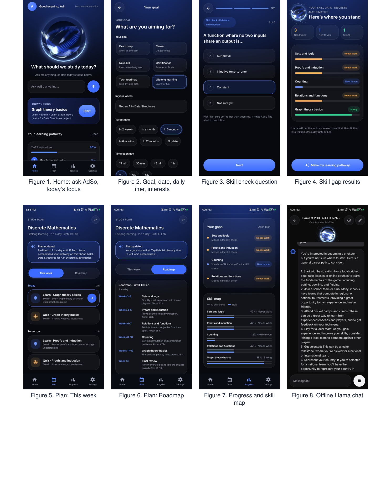
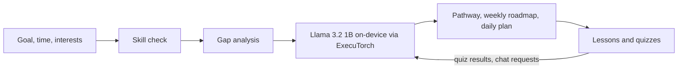

<div align="center">


# AdSo AI

### Your offline, on-device AI learning companion

Personalised learning pathways from your goals, interests and skill level, powered by **Llama 3.2** running
entirely on your phone with **ExecuTorch**. No internet. No account. Your data never leaves the device.

[](https://github.com/sohaaammmm/AdSo-AI/releases/latest)


*Bharat AI-SoC Challenge 2026–27 · Problem Statement 4 *

</div>

---

## 📱 Screenshots

<p align="center"></p>

## ✨ What AdSo does

| The brief asks for | How AdSo does it |
|---|---|
| 🎯 **Understand learner goals** | Goal type (exam prep, career, new skill, certification, tech roadmap, lifelong learning), your goal in your own words, target date (2 weeks – 12 months), daily time (15 min – 6 h) and 20 interests |
| 🔍 **Identify skill gaps** | A short skill check per course marks every topic **Strong**, **Needs work** or **New to you** |
| 🗺️ **Recommend learning pathways** | Gaps first, then new topics, strong ones as review. Llama re-orders them for your goal and explains why |
| 📅 **Generate study plans** | A day-by-day plan (Learn · Practice · Quiz · Review) and a **week-by-week roadmap** to your target date |
| 🔄 **Adapt over time** | After every quiz, Llama reviews your mistakes, gives advice and moves the next topic to the front. Change the plan just by chatting: *"I only have 2 hours a day, focus on graphs first"* |

**Also:** 8 built-in courses + any course you name (designed by Llama) · lessons written by Llama · adaptive quizzes ·
"Ask AdSo" tutor chat with history · real study-time graph · free study resources · animated 3D AI orb ·
Hindi, Tamil, Telugu, Bengali and Marathi AI answers.

## ⚡ Quick start

1. **Download** the APK from [**Releases**](https://github.com/sohaaammmm/AdSo-AI/releases/latest) and install it on an Arm 64-bit Android phone.
2. **Open AdSo AI** and tap **Download** on *"Get AdSo's AI"*. The model (1.18 GB) downloads once; Wi-Fi is recommended.
3. **Done.** Set your goal, take the skill check and get your plan, all offline from now on.

<details>
<summary><b>Prefer to copy the model with a PC (adb)?</b></summary>

Get `Llama-3.2-1B-Instruct-QLORA_INT4_EO8.pte` and `tokenizer.model` from
[executorch-community on Hugging Face](https://huggingface.co/executorch-community/Llama-3.2-1B-Instruct-QLORA_INT4_EO8-ET), then:

```bash
adb shell mkdir -p /data/local/tmp/llama
adb push Llama-3.2-1B-Instruct-QLORA_INT4_EO8.pte tokenizer.model /data/local/tmp/llama/
```
</details>

## 🧠 How it works



A deterministic planning engine owns structure (levels, ordering, hours, schedule); Llama does the reasoning and
language (personalised order and reasons, lessons, quiz advice, chat). Every Llama task is short and returns JSON
that the app validates, with safe fallbacks.

## 📊 Performance

Measured on a **TECNO POVA 5 Pro 5G** (MediaTek Dimensity 6080: 2× Cortex-A76 + 6× Cortex-A55, 8 GB RAM), airplane mode.

| Metric | Result |
|---|---|
| Model | Llama 3.2 1B Instruct, QAT+LoRA, INT4 weights / 8-bit activations (1.18 GB) |
| Runtime | ExecuTorch 1.1.0 · XNNPACK · Arm KleidiAI kernels |
| Model load | 7.0 s |
| Generation | 7.9 tokens/s (prefill 29 tokens/s) |
| Advice after a quiz | 3.5 s |
| CPU while generating | ≈ 190–260 % (mostly the two Cortex-A76 cores) |
| Memory | model ≈ 1.62 GB, whole app ≈ 1.9 GB |
| APK size | 20 MB |
| Offline | 100 % after the one-time download |

Full details: [technical report](docs/technical-report.md).

## 🛠️ Build from source

```bash
git clone https://github.com/sohaaammmm/AdSo-AI.git
cd AdSo-AI
./gradlew assembleRelease   # → app/build/outputs/apk/release/app-release.apk
```

Requires JDK 17 or 21 and the Android SDK. The 3D orb is prebuilt; to rebuild it run `npm install && npm run build` in `orb/`.

<details>
<summary><b>Project structure</b></summary>

```
app/src/main/java/.../adso/
 ├─ AdsoActivity.kt         single activity, Jetpack Compose navigation
 ├─ AdsoViewModel.kt        goals, skill check, pathway, plan, roadmap, quiz, coach, chat, progress
 ├─ llm/LlamaEngine.kt      ExecuTorch LlmModule wrapper (load, stream, stop, model choice)
 ├─ llm/Advisor.kt          prompts, JSON parsing, fallbacks
 ├─ llm/ModelDownloader.kt  one-time model download with resume + SHA-256 check
 ├─ data/                   Room database, courses, resources
 └─ ui/                     screens
orb/                        React Three Fiber source of the animated orb
docs/                       technical report, design assets
```
</details>

## 🙏 Credits and license

Built on the ExecuTorch Llama Android demo from
[meta-pytorch/executorch-examples](https://github.com/meta-pytorch/executorch-examples)
(original README: [docs/ExecuTorch-LlamaDemo-README.md](docs/ExecuTorch-LlamaDemo-README.md)).
BSD license, see [LICENSE](LICENSE). Llama 3.2 is licensed by Meta under the Llama 3.2 Community License.
PyTorch ExecuTorch with XNNPACK and Arm KleidiAI · Jetpack Compose · Room · three.js / React Three Fiber ·
Inter font (SIL OFL).
